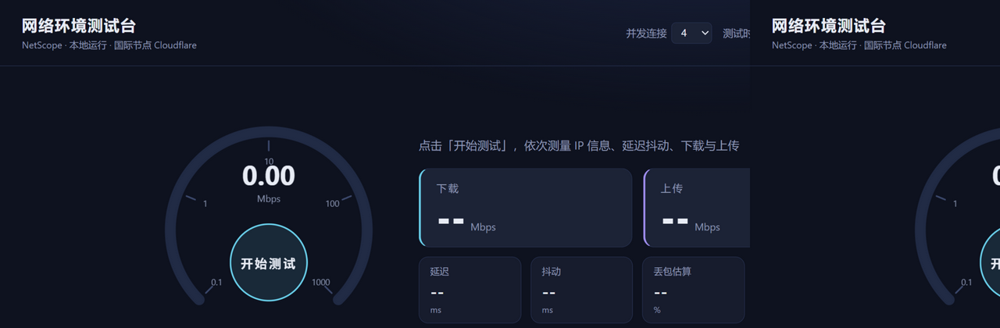

# 网络环境测试台 · NetScope

本地运行、浏览器打开即用的网络测试工具。主测速结果（**下载 / 上传**大卡片）一目了然，配套延迟、抖动、丢包、延迟膨胀（Bufferbloat）等指标与适用性评估，并支持**多节点对比**与**系统级诊断**，帮助定位网络问题出在哪一环。

纯前端核心零依赖；所有请求经 HTTPS 发往公共测速端点，页面与数据完全保留在本机。



## 使用方式

### 方式一：双击打开（零依赖）

直接双击 `index.html`，点击「开始测试」。

- 可用功能：主测速（下载/上传/延迟/抖动/丢包/膨胀）、IP 与运营商信息、代理检测提示、实时曲线、历史记录、多节点对比中的 Cloudflare 国际节点。

### 方式二：启动诊断服务器（推荐，功能全开）

```bash
python server.py            # 启动并自动打开浏览器（默认 http://127.0.0.1:8000）
python server.py --port 9000   # 换端口
python server.py --no-open     # 不自动打开浏览器
```

额外解锁：**国内节点对比测速、IPv4/IPv6 双栈检测**与下方全部系统级诊断。服务器仅监听 `127.0.0.1`，仅用 Python 标准库，无需 `pip install`。

### 方式三：GitHub Pages 在线版

本仓库启用 GitHub Pages 后（Settings → Pages → 部署分支选 main），`index.html` 可直接在线使用：主测速、IP 信息、曲线与历史均可用；国内节点对比与系统级诊断依赖本地 server.py，在线版会自动隐藏这些入口，属预期行为。

## 页面结构（信息重要性自上而下）

1. **主测速区**：仪表盘 + 「下载 / 上传」两张大卡片（测试中当前阶段高亮发光，完成时数字弹跳），下方延迟 / 抖动 / 丢包 / 膨胀四张小卡片。顶栏可调并发连接数（4/8/16，千兆宽带建议 8+）与测试时长。
2. **实时速率曲线**：下载（青）/ 上传（紫）两段速率过程。
3. **多节点对比测速**：一键对比 Cloudflare（国际，浏览器直测）与腾讯 / 阿里 / 清华（国内，经 server.py 中转），并附 IPv4 / IPv6 双栈通道，自动给出「宽带慢还是国际链路慢」的结论。
4. **测试结论**：4K 流媒体 / 视频会议 / 竞技网游 / 大文件下载 / 日常网页适用性判定 + 延迟膨胀等级（A+ ~ F）。
5. **网络环境信息**：公网 IP、运营商/ASN、位置、Cloudflare 节点、IP 类型、代理检测（出口属地时区 vs 浏览器时区）。
6. **系统级诊断**（需 server.py）：

| 诊断项 | 说明 |
|--------|------|
| WiFi 信号质量 | 信号强度、协商速率、频段（如 2.4GHz 会提示更换 5GHz/有线） |
| 本机网络摘要 | 主机名、网卡 IP、默认网关、DNS 服务器 |
| ICMP Ping | 真实 ping，含丢包率与延迟统计（阿里 / Google DNS 目标） |
| 每跳丢包 | `pathping`，定位丢包发生在哪一跳（约 1 分钟） |
| 路由追踪 | `tracert` 路径可视化原始输出 |
| DNS 污染对比 | 系统 / 阿里 / 腾讯 / Google / 阿里 DoH 五路结果对比 |
| 端口连通 | TCP 443（百度 / GitHub）、53 端口握手测试 |

## 测试指标说明

| 指标 | 含义 | 实现方式 |
|------|------|----------|
| 下载 / 上传 | 稳定期吞吐量（跳过 TCP 慢启动预热段） | 多连接并行持续拉流 / POST 随机数据 |
| 延迟 | 空载 RTT（丢弃首个建连样本） | 对 `__down?bytes=0` 计时 |
| 抖动 | 相邻两次延迟差绝对值的均值 | 由延迟采样序列计算 |
| 丢包估算 | HTTP 层探测失败占比（非 ICMP） | 延迟探测失败计数 |
| 延迟膨胀 | 满载时延迟劣化程度，A+ ~ F 分级 | 测速期间每 400ms 并发延迟探测对比空载 |

## 文件结构

```
Web_Test/
├── index.html   # 页面结构
├── style.css    # 深色仪表盘样式
├── app.js       # 测试引擎（测速、对比、图表、结果、历史）
├── server.py    # 可选诊断服务器（仅标准库）
└── README.md
```

## 结果偏低或异常时的排查路径

1. **先跑对比测速**：国内快国际慢 → 国际出口拥塞（晚高峰常见），宽带本身没问题；
2. **看双栈**：IPv4 慢 IPv6 快（或相反）→ 在路由器/系统调整协议优先级；
3. **查 WiFi**：信号 < 75% 或协商速率低 / 2.4GHz → 换 5GHz 或网线；
4. **每跳丢包**：定位丢包节点，作为向运营商报障的证据；
5. **DNS 对比**：解析不一致 → 路由器 DNS 改为 223.5.5.5 / 119.29.29.29；
6. **代理检测**：提示疑似代理时，先关代理再测，否则测的是代理链路。

## 技术原理

- 国际测速端点：`speed.cloudflare.com/__down` / `__up`，官方开放 CORS，纯静态页面即可实测（注意 `bytes` 参数上限约 100MB，超出会被钳制，故用 25MB 分段）；
- 国内节点：server.py 以 `Range` 断点直连腾讯 / 阿里 / 清华 CDN（已验证支持），测的是本机真实下行；
- 双栈检测：按协议族（AF_INET / AF_INET6）直接建 TLS 连接分段拉流，各 3 条并行聚合；
- 下载用 `fetch` + `ReadableStream` 逐块计数，上传用 `XHR.upload.onprogress`；
- IP / 归属信息来自 `cf-meta-ip` 响应头、`cdn-cgi/trace` 与 `ipwho.is`；
- 历史记录仅存浏览器 localStorage，可随时清空。

## 免责声明

本项目为个人开源工具，与 Cloudflare、腾讯、阿里、清华 TUNA 等测速节点提供方无任何关联。测速结果受时段、链路拥塞、WiFi 环境等多种因素影响，仅供参考，不作为服务质量评价或维权依据的唯一凭证。

## 开源许可

[MIT](LICENSE)
